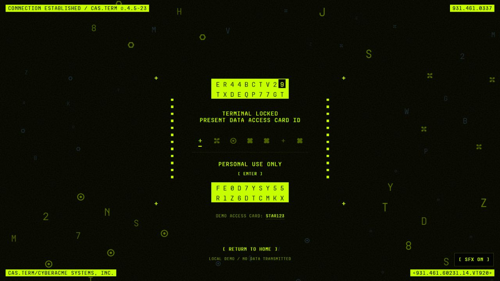

# StarYuki / STAR.CORE Frontend Replica

基于 [staryuki.com](https://staryuki.com/) 公开前端制作的独立复刻：保留黑色与荧光黄绿界面、PEONIA 字符花朵和 CRT 访问终端，可在本地直接运行。



## 运行

需要 **Node.js 22 或更新版本**，无需安装依赖。

```sh
git clone https://github.com/YOUYCG/staryuki-front-replica.git
cd staryuki-front-replica
npm start
```

- 首页：<http://localhost:4173/>
- 登录终端：<http://localhost:4173/login/>
- Windows 也可双击 `start.bat`。

请通过 HTTP 服务访问；页面资源使用站点根路径，不能直接双击 HTML 文件运行。静态部署时将 `dist/` 设为站点根目录。

## 功能

- 响应式首页、移动端菜单及 ACCESS 入口。
- 独立 PEONIA Canvas：花朵生长、字符／圆点／像素切换、鼠标交互。
- 系统状态区、模块卡片、滚动显现、标题字符解码、故障视觉效果。
- CRT 登录终端：启动、七位访问卡输入、粘贴、退格、Enter 验证、错误恢复与重置。
- 19 组本地音效，覆盖启动、输入、扫描、拒绝和成功；支持静音和偏好保存。
- 键盘焦点、Esc 关闭菜单、减少动态效果偏好、后台动画与声音暂停。

## 体验终端

点击 **TRANSMIT**，输入演示访问码 **`STAR123`**，也可以点击页面中的示例码。

这是浏览器中的本地演示，没有接入真实账户或认证服务。访问码不会发送到服务器或保存到浏览器存储。`localStorage` 仅保存静音偏好。

## 音效

音效事件和触发时序参考原站公开 launcher，例如验证扫描间隔为 300 毫秒，成功后逐格提示间隔为 60 毫秒。

原音频注册表在获取时返回 HTTP 502，因此当前提供的是**本地合成近似音效**，不宣称与原录音完全一致。首次点击或按键后，浏览器才会启用音频；右下角 **SFX** 按钮可静音。

重新生成音效：

```sh
node generate-sounds.mjs
```

## 检查

```sh
npm run check
```

服务器运行时可进一步检查两页路由、资源和音频响应类型：

```sh
node verify.mjs --url http://localhost:4173
```

检查内容包含 JavaScript 语法、本地资源完整性、WAV 文件头、有效音量、削波余量以及静态服务器拒绝 POST 请求。

## 目录

```text
dist/
  index.html            首页
  app.js                菜单、加载和滚动交互
  styles.css            首页补充样式
  effects.js            背景点阵与故障效果
  peonia.js             独立花朵视觉程序
  login/index.html      登录终端
  login.js, login.css   本地访问卡交互
  sound.js, sound.css   音效播放和开关
  audio/                本地 WAV 与来源说明
  vendor/               p5.js 与许可证
server.mjs              无依赖静态服务器
generate-sounds.mjs      本地音效生成器
verify.mjs              检查脚本
```

## 来源和许可证

项目原创实现部分采用 [MIT 许可证](LICENSE)。原站页面布局、CSS、品牌图像、字体及 PEONIA 视觉程序属于第三方内容，**不包含在本项目的 MIT 授权范围内**；具体范围见 [第三方内容说明](THIRD_PARTY_NOTICES.md)。

原站公开资源于 2026-10-11 获取。p5.js 1.11.11 的 LGPL 2.1 许可证随库保留。仓库用于前端学习与视觉复现；第三方素材的使用应遵循各自授权。
